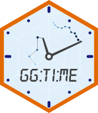

{style="float:right;padding: 0 0 0 10px;" fig-alt="ggtime Hex Logo" width="175"}

## Course Overview

Modern time-series datasets are hard to explore: they contain a large number of frequently observed series, each with many patterns of its own. This workshop introduces exploratory techniques to uncover meaningful temporal patterns in time series data.

Time series data can be tricky to represent correctly, especially when the data spans multiple timezones and granularities. The correct representation of time is essential for accurate analysis, and we'll see how to avoid common errors in mixed-granularity operations such as temporal aggregation.

Next we'll explore how to compare patterns across many series using feature-based statistical summaries. Visualising these features reveals common temporal patterns at scale, allowing us to quantify and cluster the dynamics of entire collections of time series.

Finally we'll visually explore individual time series in detail, using simple plot helpers to quickly create charts that highlight common time series patterns. We'll also leverage the flexibility of the grammar of time series graphics to uncover more complex patterns, such as visualising seasonality  across time zones and using calendar plots to reveal holiday effects.

This practical workshop features live demonstrations and hands-on exercises using real-world data, built around tidy time series tools that extend the tidyverse and ggplot2: `feasts`, and the new packages `mixtime` and `ggtime`. Participants will leave with practical skills to accurately explore and visualise time series data in R.

This workshop will run in-person at [WOMBAT 2026](https://wombat2026.numbat.space/) in Melbourne, Australia on November 30th 2026, from 1:30pm to 5:00pm (3 hours of content with a 30 minute break).

<!-- ## Registration -->

## Learning objectives

Participants will learn how to:

1.  Use the tidyverse to wrangle and manipulate time series data
2.  Visualise data and identify common time series patterns
3.  Use time series features to find patterns in many time series
4.  Apply the grammar of time series graphics to visualise complex seasonalities

# Educators

## Instructor

{style="float:right;padding: 0 0 0 10px;" fig-alt="Headshot of Mitchell O'Hara-Wild" width="200"}
[**Mitchell O'Hara-Wild**](https://mitchelloharawild.com/) (he/him) is a PhD candidate at [Monash University](https://www.monash.edu), creating new techniques and tools for forecasting large collections of time series with Rob Hyndman and George Athanasopoulos. He is the lead developer of the tidy time-series forecasting tools fable and feasts, and has co-developed the widely used forecast package since 2015. He is an award-winning educator, and has taught applied forecasting at Monash University and various forecasting workshops around the world.

<div align="center">
<a href="https://www.mitchelloharawild.com"></a>&ensp;
<a href="https://github.com/mitchelloharawild"></a>&ensp; 
<a href="https://twitter.com/mitchoharawild"></a>&ensp; 
<a href="https://www.linkedin.com/in/mitchelloharawild/"></a>&ensp;&emsp;
</div>


# Preparation

The workshop will provide a quick-start overview of exploring time series data. There is no need for prior experience in time series to get the most out of this workshop.

It is expected that you are comfortable with writing R code and using tidyverse packages including dplyr and ggplot2. If you are unfamiliar with writing R code or using the tidyverse, consider working through the learnr materials here: <https://learnr.numbat.space/>.

Some familiarity with statistical concepts such as the mean, variance, quantiles, normal distribution, and regression would be helpful, although this is not strictly necessary.

## Required equipment

Please bring your own laptop capable of running R.

## Required software

To be able to complete the exercises of this workshop, please install a suitable IDE (such as RStudio), a recent version of R (4.1+), and the packages fpp3, feasts, mixtime, and ggtime, which can all be installed with the code below.

```r
install.packages(c("fpp3", "feasts", "mixtime", "ggtime"))
```

If you installed these packages before the workshop week, please run this again to get the latest versions.

Please have the required software installed before attending the workshop.

::: {.callout-note collapse="true"}
## Optional: development versions

Some workshop examples use features newer than the CRAN releases. The slides can still be followed with the CRAN versions, but these examples may differ or error.

- Seasonal peaks and level shifts shown as times (rather than integers) need the development version of feasts:

```r
# install.packages("pak")
pak::pak("tidyverts/feasts")
```

- `stat_summary_time()` in ggtime is not yet available in a public release or branch, so there is no install command for it. If it is released on CRAN before the workshop, update ggtime with `install.packages("ggtime")`.
:::
