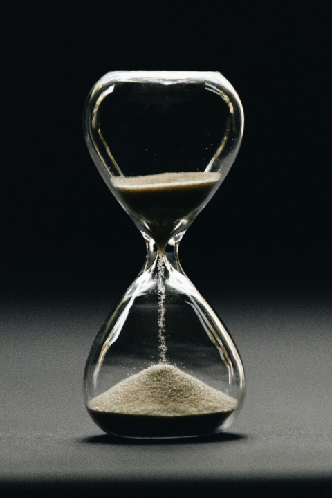

```{r}
#| label: workshop-data
#| include: false
#| cache: false
library(fpp3)
library(mixtime) # Load last

# Use mixtime for the time index of each dataset
aus_production <- aus_production |>
  mutate(Quarter = yearquarter(Quarter))
PBS <- PBS |>
  mutate(Month = yearmonth(Month))
vic_elec <- vic_elec |>
  mutate(Time = mixtime(Time))
pedestrian <- pedestrian |>
  mutate(Date_Time = mixtime(Date_Time))
tourism <- tourism |>
  mutate(Quarter = yearquarter(Quarter))
```

```{r}
#| include: false
#| cache: false
source("../R/morph/common/morph.R")
source("../R/morph/season.R")
source("../R/morph/subseries.R")
source("../R/loop-slider.R")
```

```{=html}
<script src="../libs/d3.min.js"></script>
<script src="../libs/plot.umd.min.js"></script>
<script src="../libs/loop-slider.js"></script>
```

## {}

::: columns
::: {.column width="40%"}
:::
::: {.column width="60%"}

::: {.title data-id="title"}
Exploratory time series analysis
:::

::: {.subtitle data-id="subtitle"}
Seasons and calendrical patterns
:::

::: {.dateplace}
30th November 2026 @ WOMBAT 2026
:::

##### Mitchell O'Hara-Wild, Nectric

::: {.callout-link}

## Useful links

{.icon} [social.mitchelloharawild.com](https://social.mitchelloharawild.com/)

{.icon} [workshop.nectric.com.au/wombat2026/](https://workshop.nectric.com.au/wombat2026/)

{.icon} [mitchelloharawild/workshop-etsa-wombat2026](https://github.com/mitchelloharawild/workshop-etsa-wombat2026)


:::

:::
:::

{.image-left}

## {}

::: columns

::: {.column width="40%"}
:::

::: {.column width="60%"}

### Setup

Restarted R? Catch up from the first session.

<!-- The code run at the top of these slides -->

```{r}
#| ref.label: workshop-data
#| echo: true
#| eval: false
```

:::
:::

{.image-left}

## {}

::: columns

::: {.column width="40%"}
:::

::: {.column width="60%"}

### Visualising temporal patterns

Recall the time plot allowed us to identify temporal patterns including trend, seasonality, and cycles.

```{r}
#| echo: true
pbs_scripts <- PBS |>
  summarise(Scripts = sum(Scripts))
pbs_scripts |>
  autoplot(Scripts)
```

:::
:::

{.image-left}


## {}

::: columns

::: {.column width="40%"}
:::

::: {.column width="60%"}

### Visualising temporal patterns

Creating a time plot with `autoplot()` is quick and easy. A time plot can also be made with the grammar of time series graphics for more options.

```{r}
#| echo: true
pbs_scripts |>
  ggplot(aes(x = Month, y = Scripts)) +
  geom_time_line()
```

:::
:::

{.image-left}

## {}

::: columns

::: {.column width="40%"}
:::

::: {.column width="60%"}

### Time scales

Axis breaks use durations, and labels use calendar components.

```{r}
#| echo: true
pbs_scripts |>
  ggplot(aes(x = Month, y = Scripts)) +
  geom_time_line() +
  scale_x_mixtime(
    time_breaks = years(2L),
    time_labels = "{lin(year)}"
  )
```

`lin()` is linear time, `cyc()` is cyclical time (e.g. `{cyc(month, year)}`).

:::
:::

{.image-left}


## {}

::: columns

::: {.column width="40%"}
:::

::: {.column width="60%"}

### Visualising temporal patterns

The time plot allows us identify the presence of seasonality, but it is less effective in seeing the **shape** of seasonal patterns.

::: fragment

::: callout-caution
## Question

How else could we represent time to more clearly show annual seasonal patterns?

:::
:::

:::
:::

{.image-left}

## {}

::: columns

::: {.column width="40%"}
:::

::: {.column width="60%"}

### Visualising seasonality

Looping the plot's x-axis around each year arranges *linear* time (year month) *cyclically* (month of year), which highlights seasonal patterns.

::: callout-caution
## Your turn

Loop the time axis of this plot with `coord_loop()`.

```{r}
#| echo: true
#| eval: false
pbs_scripts |>
  ggplot(aes(x = Month, y = Scripts)) +
  geom_time_line() +
  coord_loop(time_loops = ???)
```

Hint: `time_loops` is a mixtime duration, such as `weeks(2L)` for a fortnight.
:::

:::
:::

{.image-left}


## {}

::: columns

::: {.column width="40%"}
:::

::: {.column width="60%"}

### Visualising seasonality

```{r}
#| echo: true
pbs_scripts |>
  ggplot(aes(x = Month, y = Scripts)) +
  geom_time_line() +
  coord_loop(time_loops = years(1L))
```

:::
:::

{.image-left}


## {}

### How looping works

::::: {.morph-slide}

```{r}
#| label: scripts-loop
#| cache: false
#| output: asis
season_morph(
  pbs_scripts, Scripts, id = "scripts-loop",
  alt = "Animation of a time plot of monthly scripts being looped around each year into a season plot."
)
```

:::: {.morph-captions}

::: {.morph-step}
Monthly scripts in *linear* time.
:::

::: {.morph-step .fragment .fade-in-then-out}
Each month belongs to a year. Split the line between years.
:::

::: {.morph-step .fragment .fade-in-then-out}
Loop each year back to the start, one at a time.
:::

::: {.morph-step .fragment .fade-in-then-out}
The season plot: *cyclical* time.

December still connects to the next January.
:::

::::

:::::


## {}

::: columns

::: {.column width="40%"}
:::

::: {.column width="60%"}

### Visualising seasonality

```{r}
pbs_scripts |>
  ggplot(aes(x = Month, y = Scripts)) +
  geom_time_line() +
  coord_loop(time_loops = years(1L))
```

::: callout-caution
## Your turn

Describe the shape of the seasonal pattern.

When are the most scripts (the peak) and the least scripts (the trough) issued?
:::

:::
:::

{.image-left}


## {}

### Visualising seasonality

::: columns
::: {.column width="48%"}

```{r}
#| fig-height: 6.5
#| fig-width: 7
pbs_scripts |>
  ggplot(aes(x = Month, y = Scripts)) +
  geom_time_line() +
  coord_loop(time_loops = years(1L))
```

:::
::: {.column width="52%"}

::: {.poll #scripts-trough-month}
In which month are the fewest scripts usually issued?

- [x] February
- [ ] June
- [ ] September
- [ ] December
:::

:::
:::

## {}

::: columns

::: {.column width="40%"}
:::

::: {.column width="60%"}

### Why loop time?

Without `coord_loop()`, the season plot needs seasonal factors.

```{r}
#| echo: true
#| eval: false
aes(
  x = lubridate::month(Month, label = TRUE),
  group = lubridate::year(Month)
)
```

::: {.callout-important}
## Seasonal factors are error-prone

* the wrong `group` draws sawtooth lines
* December isn't connected to January
* each month has equal length
* `x` and `group` both change with the season
:::

:::
:::

{.image-left}


## {}

::: columns

::: {.column width="40%"}
:::

::: {.column width="60%"}

### Circular time

Looped time can also be drawn around a circle.

```{r}
#| echo: true
pbs_scripts |>
  ggplot(aes(x = Month, y = Scripts)) +
  geom_time_line() +
  coord_loop(
    time_loops = years(1L), coord = coord_radial()
  )
```

:::
:::

{.image-left}


## {}

::: columns

::: {.column width="40%"}
:::

::: {.column width="60%"}

### The season plot

```{r}
#| echo: true
pbs_scripts |>
  gg_season(Scripts, period = years(1L))
```

This plot is known as a **season plot**, which can be made quickly with the plot helper function `gg_season()`.

:::
:::

{.image-left}

## {}

::: columns

::: {.column width="40%"}
:::

::: {.column width="60%"}

### The seasonal period

```{r}
#| echo: true
#| eval: false
pbs_scripts |>
  gg_season(Scripts, period = years(1L))
```

The `period` argument is a `duration` for the length of the data's seasonal pattern.

It uses `coord_loop(time_loops = period)`, so that the time axis loops around each year.

Other common seasonal periods include:

* `weeks(1L)`
* `days(1L)`
* `hours(1L)`

:::
:::

{.image-left}

## {}

### What if the loop is the wrong length?

```{r}
#| label: scripts-loop-length
#| cache: false
loop_slider(pbs_scripts, "Scripts")
```

Why does 24 months also work? What about 6?


## {.fragment-remove}

::: columns

::: {.column width="60%"}

### Visualising seasonality

::: {.fragment .fade-out fragment-index=1}
The `aus_production` dataset contains the production of Australian Gas in petajoules (among other goods).
:::

```{r}
#| echo: true
aus_production |>
  autoplot(Gas)
```


::: {.fragment .fade-up fragment-index=1}
::: callout-caution
## Your turn

Plot the shape of the seasonal pattern, in which quarter does Australia produce the most and least gas?
:::
:::

:::
:::

{.image-right}


## {}

### Visualising seasonality

::: columns
::: {.column width="48%"}

```{r}
#| fig-height: 6.5
#| fig-width: 7
aus_production |>
  gg_season(Gas, period = years(1L))
```

:::
::: {.column width="52%"}

::: {.poll #gas-peak-quarter}
In which quarter does gas production peak?

- [ ] Q1
- [ ] Q2
- [x] Q3
- [ ] Q4
:::

:::
:::

## {.fragment-remove}

::: columns

::: {.column width="60%"}

### Visualising seasonality

```{r}
#| echo: true
aus_production |>
  gg_season(Gas, period = years(1L))
```

::: {.fragment .fade-out fragment-index=1}
::: callout-note
## Describing the seasonal pattern

This plot shows that peak production is in Q3 with a trough in Q1. Seasonality is getting stronger recently.
:::
:::

::: {.fragment .fade-up fragment-index=1}
::: callout-tip
## Can we do better?

It's hard to see the seasonality from the early data, how can we improve it?
:::
:::

:::
:::

{.image-right}

## {.fragment-remove}

::: columns

::: {.column width="60%"}

### Visualising seasonality

::: {.fragment .fade-out fragment-index=1}
```{r}
#| echo: true
aus_production |>
  gg_season(log(Gas), period = years(1L))
```
:::

::: {.fragment .fade-up fragment-index=1}
```{r}
#| echo: true
aus_production |>
  gg_season(Gas, period = years(1L)) +
  scale_y_log10()
```

::: {.fragment .fade-out fragment-index=2}
::: callout-note
## Plotting log transformed data

Recall that log transforming the data rescales multiplicative patterns into additive ones.
:::
:::

:::

::: {.fragment .fade-up fragment-index=2}
::: callout-tip
## Can we do better?

The trend makes it difficult to compare across and within seasons, can we remove the trend?
:::
:::

:::
:::

{.image-right}


## {.fragment-remove}

::: columns

::: {.column width="60%"}

### Visualising seasonality

::: {.fragment .fade-out fragment-index=1}
```{r}
#| echo: true
#| fig-height: 4.5
aus_production |>
  model(STL(log(Gas))) |>
  components() |>
  autoplot()
```

::: callout-tip
## STL decomposition

Recall that STL allows us to separate trend from seasonality, let's plot only the seasonal component.
:::
:::

::: {.fragment .fade-up fragment-index=1}
```{r}
#| echo: true
#| fig-height: 4.5
aus_production |>
  model(STL(log(Gas))) |>
  components() |>
  gg_season(season_year, period = years(1L))
```

::: {.fragment .fade-out fragment-index=2}
::: callout-note
## Plotting seasonality from decomposition

Removing the trend and noise allows us to clearly see the seasonal pattern, and even how it changes over time.
:::
:::

:::

::: {.fragment .fade-up fragment-index=2}
::: callout-tip
## Can we do better?

How can we more clearly see the changes in the seasonal pattern over time?
:::
:::

:::
:::

{.image-right}

## {.fragment-remove}

::: columns

::: {.column width="60%"}

### Visualising seasonality

::: {.fragment .fade-out fragment-index=1}
::: callout-tip
## Remap the aesthetics

Swap the x and colour aesthetic mappings to plot linear time on the x-axis, with colours for each quarter.
:::
:::

```{r}
#| echo: true
#| code-fold: show
aus_production |>
  model(STL(log(Gas))) |>
  components() |>
  ggplot(aes(
    x = Quarter,
    y = season_year,
    colour = format(Quarter, "Q{cyc(quarter, year)}")
  )) +
  geom_time_line() +
  labs(
    x = "Time",
    y = "Seasonality",
    colour = "Quarter",
    title = "Gas production in Australia"
  )
```


::: {.fragment .fade-up fragment-index=1}
::: callout-note
Gas production in Q1 is increasing while Q3 is decreasing.
:::
:::

:::
:::

{.image-right}

## {}

### From time plot to subseries plot

::::: {.morph-slide}

```{r}
#| label: gas-subseries
#| cache: false
#| output: asis
gas_season <- aus_production |>
  model(STL(log(Gas))) |>
  components() |>
  as_tsibble() |>
  select(Quarter, season_year)
subseries_morph(
  gas_season, season_year, id = "gas-subseries",
  alt = "Animation of a time plot of the seasonal component of gas production being separated by quarter into a seasonal subseries plot."
)
```

:::: {.morph-captions}

::: {.morph-step}
The seasonal component of log gas production.
:::

::: {.morph-step .fragment .fade-in-then-out}
Each observation belongs to a quarter.
:::

::: {.morph-step .fragment .fade-in-then-out}
Join observations from the same quarter: four subseries.
:::

::: {.morph-step .fragment .fade-in-then-out}
Place the subseries side by side to compare quarters.
:::

::: {.morph-step .fragment .fade-in-then-out}
Add the mean of each quarter: the seasonal subseries plot.
:::

::::

:::::


## {.fragment-remove}

::: columns

::: {.column width="60%"}

### Visualising seasonality

::: callout-tip
## Facet by season

This produces a 'seasonal sub-series plot', which is useful for visualising changes in seasonality over time.
:::

```{r}
#| echo: true
#| fig-height: 3.5
#| code-fold: show
aus_production |>
  model(STL(log(Gas))) |>
  components() |>
  ggplot(aes(x = Quarter, y = season_year)) +
  geom_time_line() +
  facet_grid(
    cols = vars(format(Quarter, "Q{cyc(quarter, year)}"))
  )
```

:::
:::

{.image-right}

## {}

::: columns

::: {.column width="40%"}
:::

::: {.column width="60%"}

### The seasonal subseries plot

```{r}
#| echo: true
aus_production |>
  gg_subseries(Gas, period = years(1L))
```

This plot is known as a **seasonal subseries plot**, which can be made quickly with the plot helper function `gg_subseries()`.

:::
:::

{.image-left}

## {}

::: columns

::: {.column width="40%"}
:::

::: {.column width="60%"}

### The seasonal subseries plot

::: callout-tip
## Seasonal decomposition advised

Seeing changes in seasonality when the data has trend, noise, and other patterns is tricky! This plot works best in combination with STL decomposition.
:::

```{r}
#| echo: true
#| fig-height: 4.5
aus_production |>
  model(STL(log(Gas))) |>
  components() |>
  gg_subseries(season_year, period = years(1L))
```


:::
:::

{.image-left}


## {}

::: columns

::: {.column width="40%"}
:::

::: {.column width="60%"}

### Changing seasonality

::: callout-caution
## Your turn!

Is the seasonal pattern in the total subsidised prescriptions (`Scripts`) in Australia changing over time?
:::

```{r}
#| echo: true
pbs_scripts <- PBS |>
  summarise(Scripts = sum(Scripts))
pbs_scripts |>
  autoplot(Scripts)
```

:::
:::

{.image-left}


## {}

### Changing seasonality

::: columns
::: {.column width="48%"}

```{r}
#| fig-height: 6.5
#| fig-width: 7
pbs_scripts |>
  model(STL(Scripts)) |>
  components() |>
  gg_subseries(season_year, period = years(1L))
```

:::
::: {.column width="52%"}

::: {.poll #scripts-december-change}
How is the December peak in scripts changing since the mid 1990s?

- [ ] Getting larger
- [x] Getting smaller
- [ ] Staying the same
:::

:::
:::

## {}

::: columns

::: {.column width="40%"}
:::

::: {.column width="60%"}

### Changing seasonality

```{r}
#| echo: true
#| fig-height: 5
pbs_scripts |>
  model(STL(Scripts)) |>
  components() |>
  gg_subseries(season_year, period = years(1L))
```

::: {.fragment .fade-up}
::: callout-note
The number of scripts in December is dropping rapidly.

They appear to be redistributed into Oct, Nov, and Jan.
:::
:::

:::
:::

{.image-left}


## {}

::: columns

::: {.column width="40%"}
:::

::: {.column width="60%"}

### Recap of plotting time series

* Time plots
* Season plots (`coord_loop()`)
* Seasonal subseries plots

:::
:::

{.image-left}


## {}

::: columns

::: {.column width="60%"}

### Complex seasonality

Complex seasonality describes two or more seasonal patterns.

Complex seasonal patterns:

* often interact with each-other
* can be based on other calendars (e.g. holidays)

::: {.fragment .fade-up}
::: callout-tip
## Frequent seasonality

Multiple seasonality is common in daily & sub-daily data.

It can be difficult to forecast, so first consider if you need daily or sub-daily forecasts for making decisions.
:::
:::

:::
:::

{.image-right}


## {}

### Victorian electricity demand

<video style="width: 100%;" src="anim/anim1.mp4" data-lazy-loaded="" data-paused-by-reveal=""><a href="anim/anim1.mp4">Video</a></video>

## {}

### Victorian electricity demand

<video style="width: 100%;" src="anim/anim2.mp4" data-lazy-loaded="" data-paused-by-reveal=""><a href="anim/anim2.mp4">Video</a></video>

## {}

### Victorian electricity demand

<video style="width: 100%;" src="anim/anim3.mp4" data-lazy-loaded="" data-paused-by-reveal=""><a href="anim/anim3.mp4">Video</a></video>


## {}

### Victorian electricity demand

<video style="width: 100%;" src="anim/anim4.mp4" data-lazy-loaded="" data-paused-by-reveal=""><a href="anim/anim4.mp4">Video</a></video>

## {}

::: columns

::: {.column width="60%"}

### Complex seasonality

There are three key strategies for clearly plotting multiple seasonal patterns:

::: {.fragment .fade-up}
::: callout-note
## Temporal aggregation

Sum over finer-grained seasonal patterns.

Useful for annual seasonality.
:::
:::

::: {.fragment .fade-up}
::: callout-note
## Calendar plots

Lay out time like a calendar.

Useful for holidays and sub-daily patterns.
:::
:::

::: {.fragment .fade-up}
::: callout-note
## Seasonal decomposition

Separate each seasonal pattern with MSTL (multiple STL).

Best for daily / weekly seasonality.
:::
:::

:::
:::

{.image-right}


## {}

::: columns

::: {.column width="60%"}

### Temporal aggregation

The Victorian electricity demand data has three seasonal patterns:

* Annual (weather)
* Weekly (work)
* Daily (sleep)

The original data has a 30 minute frequency.

```{r}
#| echo: true
vic_elec
```

:::
:::

{.image-right}


## {}

::: columns

::: {.column width="60%"}

### Temporal aggregation

When plotted at a 30 minute frequency, it is difficult to see any seasonal pattern clearly.

```{r}
#| echo: true
vic_elec |>
  autoplot(Demand)
```

:::
:::

{.image-right}

## {.fragment-remove}

::: columns

::: {.column width="60%"}

### Temporal aggregation

::: {.fragment .fade-out fragment-index=1}
Aggregation to a weekly frequency will sum over the daily and weekly patterns.
:::

```{r}
#| echo: true
#| fig-height: 4.5
vic_elec |>
  index_by(Week = yearweek(Time)) |>
  summarise(Demand = sum(Demand)) |>
  autoplot(Demand)
```

::: {.fragment .fade-up fragment-index=1}
::: callout-important
## Partial aggregation

When aggregating time, you need to ensure the aggregation window has all necessary data. 
:::
:::

:::
:::

{.image-right}

## {.fragment-remove}

::: columns

::: {.column width="60%"}

### Temporal aggregation

```{r}
#| echo: true
#| fig-height: 4.5
#| code-line-numbers: "5-6"
vic_daily <- vic_elec |>
  index_by(Day = date(Time)) |>
  summarise(Demand = sum(Demand))
vic_weekly <- vic_daily |>
  # Only days in weeks with all 7 days
  filter(time_is_complete_at(Day, cal_isoweek$week)) |>
  index_by(Week = yearweek(Day)) |>
  summarise(Demand = sum(Demand))
vic_weekly |>
  autoplot(Demand)
```


:::
:::

{.image-right}

## {}

::: columns

::: {.column width="60%"}

### Temporal aggregation

`stat_summary_time()` aggregates within the plot.

```{r}
#| echo: true
#| fig-height: 3.5
vic_daily |>
  ggplot(aes(x = Day, y = Demand)) +
  geom_time_line(colour = "grey60") +
  stat_summary_time(
    granule = weeks(1L), fun = mean,
    colour = "steelblue", linewidth = 1
  )
```

Incomplete weeks become `NA`.

:::
:::

{.image-right}


## {.fragment-remove}

::: columns

::: {.column width="60%"}

### Temporal aggregation

```{r}
#| echo: true
#| fig-height: 4.5
vic_weekly |>
  gg_season(
    Demand,
    period = years(1L, calendar = cal_isoweek)
  )
```

::: callout-tip
## Which year?

Weeks can span two Gregorian years, so they loop around the ISO week calendar's years.
:::

:::
:::

{.image-right}

## {.fragment-remove}

::: columns

::: {.column width="60%"}

### Temporal aggregation

The `pedestrian` dataset contains the hourly number of pedestrians at various places in Melbourne, Australia.

```{r}
#| echo: true
pedestrian |>
  filter(Sensor == "Southern Cross Station") |>
  autoplot(Count)
```


:::
:::

{.image-right}

## {.fragment-remove}

::: columns

::: {.column width="60%"}

### Temporal aggregation

```{r}
#| echo: true
pedestrian |>
  filter(Sensor == "Southern Cross Station") |>
  index_by(Day = date(Date_Time)) |>
  summarise(Count = sum(Count)) |>
  filter(time_is_complete_at(Day, cal_isoweek$week)) |>
  index_by(Week = yearweek(Day)) |>
  summarise(Count = sum(Count)) |>
  gg_season(
    Count,
    period = years(1L, calendar = cal_isoweek)
  )
```


:::
:::

{.image-right}

## {.fragment-remove}

::: columns

::: {.column width="60%"}

### Temporal aggregation

Since there doesn't appear to be (substantial) annual seasonality, we can use aggregation to look for weekly seasonality.

::: callout-caution
## Your turn!
Use `date()` with `index_by()` to aggregate to daily data, then use `gg_season()` to plot the weekly seasonal pattern.

Here's some code to start:

```{r}
#| echo: true
#| eval: false
pedestrian |> 
  filter(Sensor == "Southern Cross Station") |> 
  index_by(???) |>
  summarise(Count = sum(Count)) |>
  gg_season(???)
```

:::

:::
:::

{.image-right}


## {.fragment-remove}

::: columns

::: {.column width="60%"}

### Temporal aggregation

```{r}
#| echo: true
pedestrian |>
  filter(Sensor == "Southern Cross Station") |>
  index_by(Day = date(Date_Time)) |>
  summarise(Count = sum(Count)) |>
  gg_season(Count, period = weeks(1L))
```


:::
:::

{.image-right}

## {}

::: columns

::: {.column width="40%"}
:::

::: {.column width="60%"}

### Time zones

Local time repeats when daylight saving ends.

```{r}
#| echo: true
x <- datetime(
  "2026-04-05 01:30:00",
  tz = "Australia/Melbourne"
)
x + hours(1:2)
```

::: {.fragment .fade-up}
A day isn't always 24 hours!

```{r}
#| echo: true
x + days(1L)
x + hours(24L)
```
:::

:::
:::

{.image-left}


## {}

::: columns

::: {.column width="40%"}
:::

::: {.column width="60%"}

### Absolute and local time

Sub-daily time is shown in absolute time.

```{r}
#| echo: true
#| fig-height: 4
dst <- vic_elec |>
  filter(
    date(Time) >= date("2012-03-31"),
    date(Time) <= date("2012-04-02")
  )
dst |>
  ggplot(aes(x = Time, y = Demand)) +
  geom_time_line() +
  scale_x_mixtime(time_breaks = days(1L))
```

Daylight saving ended at 3am on 1 April 2012.

:::
:::

{.image-left}


## {}

::: columns

::: {.column width="40%"}
:::

::: {.column width="60%"}

### Absolute and local time

Use `tz = NA` for local time, changes are dashed.

```{r}
#| echo: true
#| fig-height: 4
dst |>
  ggplot(aes(x = Time, y = Demand)) +
  geom_time_line() +
  scale_x_mixtime(
    time_breaks = days(1L),
    time_chronon =
      cal_gregorian$minute(30L, tz = NA)
  )
```

::: {.fragment .fade-up}
Local time aligns human behaviour, absolute time shows when events coincide.
:::

:::
:::

{.image-left}


## {}

::: columns

::: {.column width="40%"}
:::

::: {.column width="60%"}

### Calendar plots

Using calendar layouts for time plots helps to visualise a large number of frequent (sub-daily) observations.

This is especially useful to show calendar specific patterns such as holidays.

```{r}
#| echo: true
#| eval: false
vic_elec |>
  filter(
    yearmonth(Time) <= yearmonth("2012 Apr")
  ) |>
  ggplot(aes(
    x = Time, y = Demand,
    colour = Holiday, group = 1
  )) +
  geom_time_line() +
  coord_calendar(
    rows = weeks(1L), cols = months(2L)
  )
```

:::
:::

{.image-left}


## {}

::: columns

::: {.column width="40%"}
:::

::: {.column width="60%"}

```{r}
#| fig-height: 10
vic_elec |>
  filter(yearmonth(Time) <= yearmonth("2012 Apr")) |>
  ggplot(aes(x = Time, y = Demand, colour = Holiday, group = 1)) +
  geom_time_line() +
  coord_calendar(rows = weeks(1L), cols = months(2L)) +
  scale_y_continuous(breaks = NULL) +
  theme(legend.position = "bottom")
```

:::
:::

{.image-left}

## {.fragment-remove}

::: columns

::: {.column width="60%"}

### Calendar plots

::: callout-caution

## Your turn!

Create a calendar plot for the first few months of pedestrians at Southern Cross Station.

Here's some code to get you started.

```{r}
#| echo: true
#| eval: false
pedestrian |> 
  filter(Sensor == "Southern Cross Station") |> 
  filter(yearmonth(Date_Time) <= yearmonth(???)) |> 
  ggplot(aes(x = ???, y = ???)) + 
  geom_time_line() + 
  coord_???(rows = ???, cols = ???)
```

Can you see any holiday effects?

:::

:::
:::

{.image-right}


## {.fragment-remove}

::: columns

::: {.column width="60%"}

```{r}
#| echo: true
#| code-fold: show
#| fig-height: 8.5
pedestrian |>
  filter(Sensor == "Southern Cross Station") |>
  filter(yearmonth(Date_Time) <= yearmonth("2015 Apr")) |>
  ggplot(aes(x = Date_Time, y = Count)) +
  geom_time_line() +
  coord_calendar(rows = weeks(1L), cols = months(2L)) +
  scale_y_continuous(breaks = NULL) +
  labs(x = "Time", y = "Pedestrian count")
```

:::
:::

{.image-right}


## {.fragment-remove}

::: columns

::: {.column width="60%"}

### Seasonal decomposition

The STL model can also decompose multiple seasonalities.

```{r}
#| echo: true
#| fig-height: 4.5
dcmp <- vic_elec |>
  model(STL(
    log(Demand) ~ season(period = "year") +
      season(period = "week") +
      season(period = "day")
  )) |>
  components()
dcmp |>
  autoplot()
```

:::
:::

{.image-right}

## {.fragment-remove}

::: columns

::: {.column width="60%"}

### Seasonal decomposition

This is effective in combination with season plots to show seasonal patterns.

```{r}
#| echo: true
dcmp |>
  gg_season(season_year, period = years(1L))
```

:::
:::

{.image-right}


## {.fragment-remove}

::: columns

::: {.column width="60%"}

### Seasonal decomposition

This is effective in combination with season plots to show seasonal patterns.

```{r}
#| echo: true
dcmp |>
  gg_season(season_week, period = weeks(1L))
```

:::
:::

{.image-right}


## {.fragment-remove}

::: columns

::: {.column width="60%"}

### Seasonal decomposition

This is effective in combination with season plots to show seasonal patterns.

```{r}
#| echo: true
dcmp |>
  gg_season(season_day, period = days(1L)) +
  scale_x_mixtime(
    time_breaks = hours(6L),
    time_labels = "{cyc(hour, day)}h"
  )
```

:::
:::

{.image-right}


## {.fragment-remove}

::: columns

::: {.column width="60%"}

### Seasonal decomposition

Specific combinations of seasonal patterns can also be computed and plotted.

::: {.fragment .fade-out fragment-index=1}
```{r}
#| echo: true
dcmp |>
  gg_season(
    season_day + season_week, period = weeks(1L)
  )
```
:::

::: {.fragment .fade-up fragment-index=1}
::: callout-important
## Caution: model limitations

Recall the STL decomposition is additive, so interactions between different seasonality will not be captured. The seasonal components are only as accurate as the model.
:::
:::

:::
:::

{.image-right}

## {.fragment-remove}

::: columns

::: {.column width="60%"}

### Seasonal decomposition

::: callout-caution
## Your turn!

Use an STL decomposition and `gg_season()` to clearly show the seasonal patterns in pedestrian traffic.

```{r}
#| echo: true
ped_dcmp <- pedestrian |>
  filter(Sensor == "Southern Cross Station") |>
  fill_gaps(Count = 0) |>
  model(STL(Count)) |>
  components()
ped_dcmp |>
  autoplot()
```

:::

:::
:::

{.image-right}


## {.fragment-remove}

::: columns

::: {.column width="60%"}

### Seasonal decomposition

```{r}
#| echo: true
ped_dcmp |>
  gg_season(season_year, period = years(1L))
```

:::
:::

{.image-right}

## {.fragment-remove}

::: columns

::: {.column width="60%"}

### Seasonal decomposition

```{r}
#| echo: true
ped_dcmp |>
  gg_season(season_week, period = weeks(1L))
```

::: {.fragment .fade-up}
::: callout-important
## Interaction effects

The weekly seasonal pattern interacts with the daily seasonal pattern, so the model doesn't work here.
:::
:::

:::
:::

{.image-right}

## {.fragment-remove}

::: columns

::: {.column width="60%"}

### Seasonal decomposition

```{r}
#| echo: true
ped_dcmp |>
  gg_season(season_day, period = days(1L)) +
  scale_x_mixtime(
    time_breaks = hours(6L),
    time_labels = "{cyc(hour, day)}h"
  )
```

::: callout-important
## Interaction effects

The weekly seasonal pattern interacts with the daily seasonal pattern, so the model doesn't work here.

:::

:::
:::

{.image-right}


## {.fragment-remove}

::: columns

::: {.column width="60%"}

### Seasonal decomposition

::: callout-tip
## Interaction effects

Combine interacting seasonalities and use colour (or facets) to separate the interactions (e.g. weekday and weekend effects).
:::

::: {.fragment .fade-out fragment-index=1}

```{r}
#| echo: true
#| eval: false
ped_dcmp |>
  as_tsibble() |>
  mutate(
    Weekday =
      day_of_week(Date_Time) < day_of_week(6L)
  ) |>
  ggplot(aes(
    x = Date_Time, y = season_day + season_week,
    colour = Weekday, group = 1
  )) +
  geom_time_line(alpha = 0.2) +
  coord_loop(time_loops = days(1L)) +
  scale_x_mixtime(
    time_breaks = hours(6L),
    time_labels = "{cyc(hour, day)}h"
  )
```
:::


::: {.fragment .fade-up fragment-index=1}
```{r}
#| echo: false
#| fig-height: 4.5
ped_dcmp |>
  as_tsibble() |>
  mutate(
    Weekday =
      day_of_week(Date_Time) < day_of_week(6L)
  ) |>
  ggplot(aes(
    x = Date_Time, y = season_day + season_week,
    colour = Weekday, group = 1
  )) +
  geom_time_line(alpha = 0.2) +
  coord_loop(time_loops = days(1L)) +
  scale_x_mixtime(
    time_breaks = hours(6L),
    time_labels = "{cyc(hour, day)}h"
  )
```
:::

:::
:::

{.image-right}


## That's all we have time for!

::: columns
::: {.column width="60%"}


::: {.callout-tip}
## Learn more about forecasting

*  *Forecasting principles and practices* textbook

  Freely available online! <https://otexts.com/fpp3/>

:::

::: {.callout-note}
## I appreciate your feedback

  Short feedback form: <https://feedback.nectric.com.au/w0rw>
:::

::: {.callout-link}


## Useful links

{.icon} [social.mitchelloharawild.com](https://social.mitchelloharawild.com/)

{.icon} [workshop.nectric.com.au/wombat2026/](https://workshop.nectric.com.au/wombat2026/)

{.icon} [mitchelloharawild/workshop-etsa-wombat2026](https://github.com/mitchelloharawild/workshop-etsa-wombat2026)

:::

:::
:::

{.image-right}

<!-- Made with :heart: and [Quarto](https://quarto.org/). -->


## Unsplash credits

::: {.callout-unsplash}

## Thanks to these Unsplash contributors for their photos

```{r unsplash}
#| echo: FALSE
#| cache: TRUE
library(httr)
library(purrr)
unsplash_pattern <- "([A-Za-z0-9_-]{11})-unsplash\\.jpg"
slides <- readLines("index.qmd")
matches <- regmatches(
  slides,
  regexpr("backgrounds/[^)]+unsplash\\.jpg", slides)
)
images <- unique(basename(matches))
ids <- unique(sub(paste0(".*", unsplash_pattern), "\\1", images))

get_unsplash_credit <- function(id) {
  fallback <- sprintf("* [Photo](https://unsplash.com/photos/%s)", id)
  my_response <- tryCatch(
    httr::GET(
      "https://api.unsplash.com/",
      path = c("photos", id),
      query = list(client_id = Sys.getenv("UNSPLASH_ACCESS"))
    ),
    error = function(e) NULL
  )
  if (is.null(my_response) || httr::http_error(my_response)) {
    return(fallback)
  }

  xml <- content(my_response)
  name <- xml$user$name
  if (is.null(name)) {
    return(fallback)
  }
  desc <- xml$description %||% "Photo"
  width <- max(0, 60 - nchar(name))
  sprintf(
    "* %s: [%s%s](%s)",
    name,
    strtrim(desc, width),
    if (nchar(desc) > width) "..." else "",
    modify_url("https://unsplash.com/", path = file.path("photos", xml$id))
  )
}
htmltools::includeMarkdown(paste0(
  map_chr(ids, get_unsplash_credit),
  collapse = "\n"
))
```

:::

<!-- ## References -->
